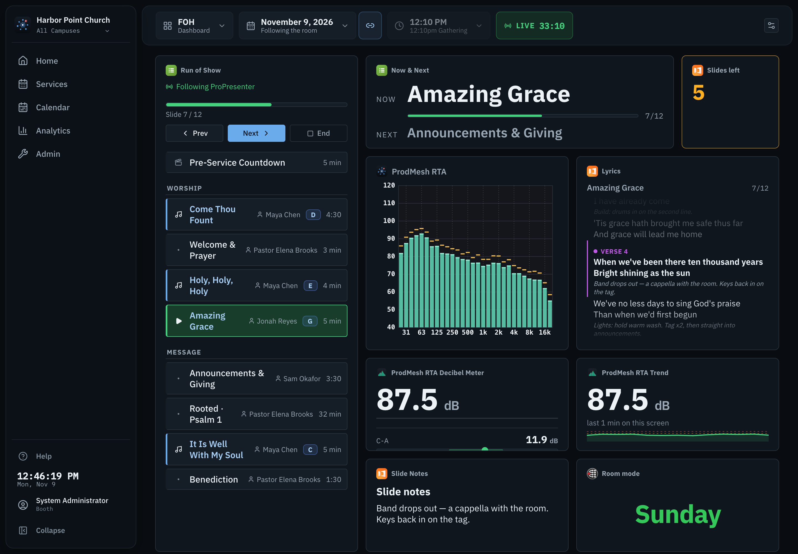
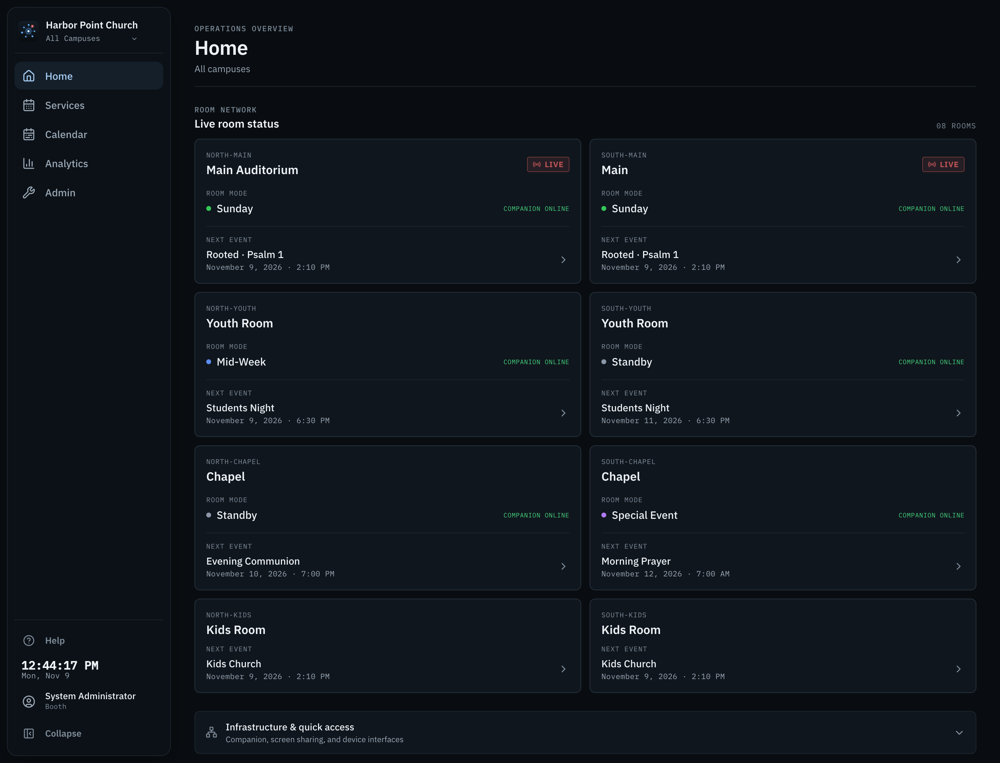
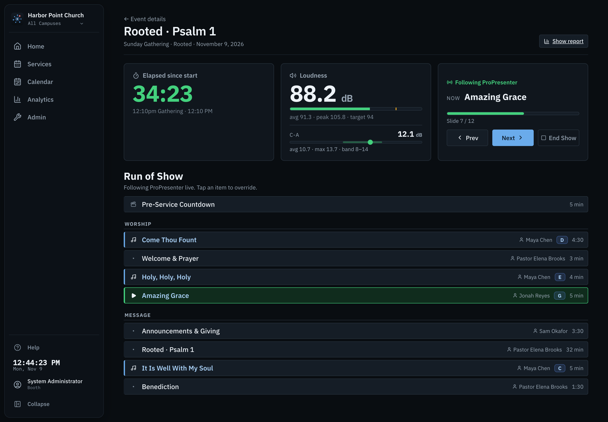
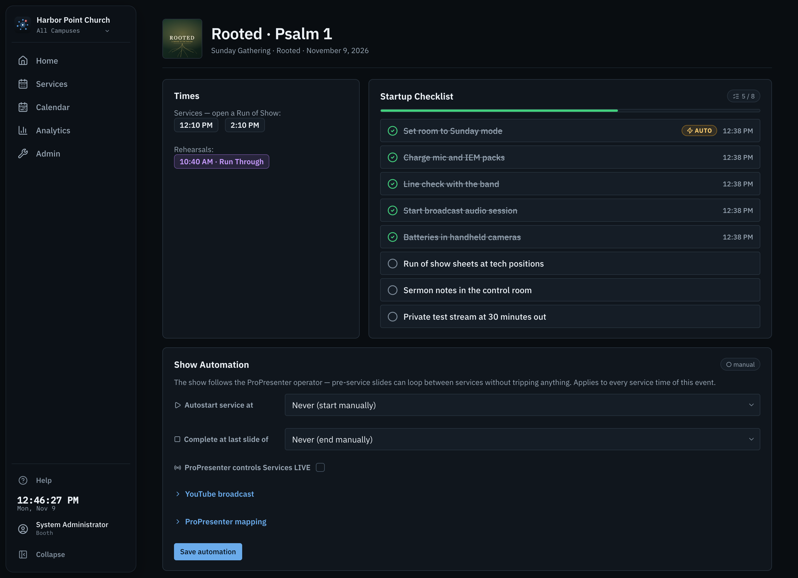
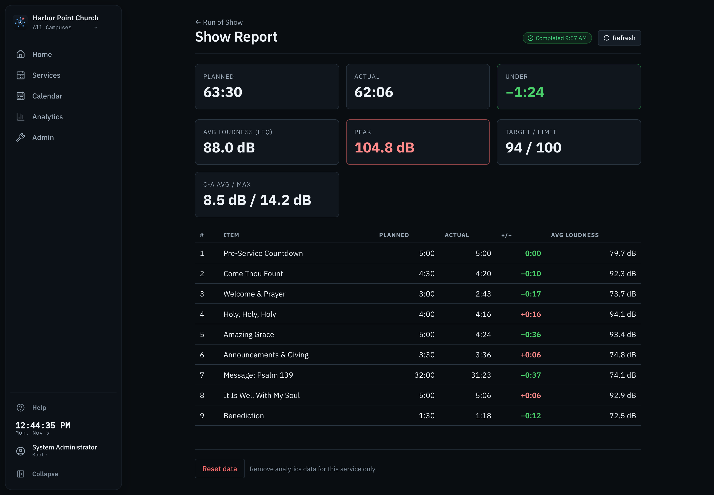
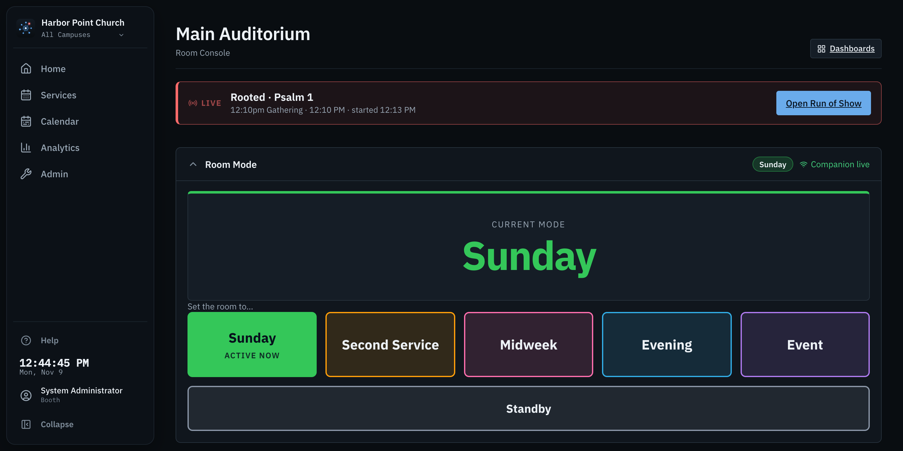
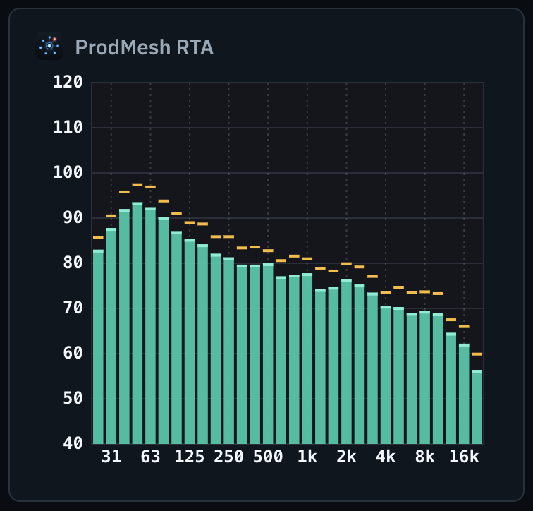
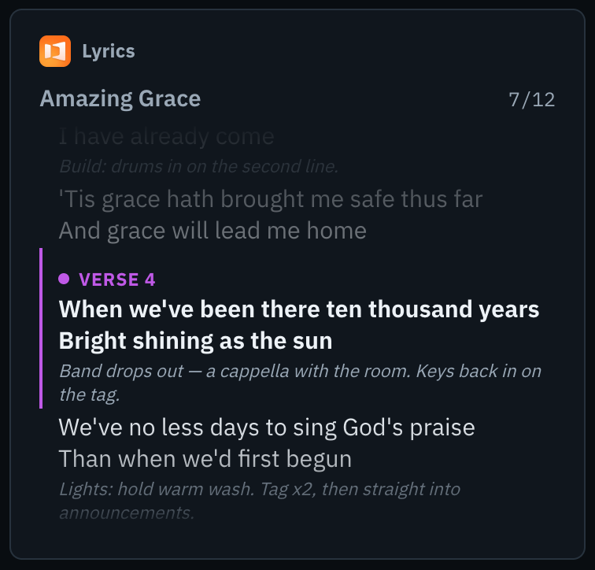

<p align="center">
  
</p>

<h1 align="center">ProdMesh</h1>

<p align="center">
  <strong>The production dashboard for church tech teams.</strong><br>
  Room control, run of show, live loudness and service data on every screen in
  the building, from one box on your own network.
</p>

<p align="center">
  <a href="https://github.com/prodmesh/prodmesh/releases/latest"></a>
  <a href="https://github.com/prodmesh/prodmesh/actions/workflows/ci.yml"></a>
  <a href="https://github.com/prodmesh/prodmesh/actions/workflows/desktop.yml"></a>
  <a href="https://github.com/prodmesh/prodmesh/actions/workflows/docker.yml"></a>
  <br>
  <a href="#install"></a>
  <a href="https://prodmesh.github.io/prodmesh/"></a>
  <a href="LICENSE"></a>
</p>

<p align="center">
  
</p>

One always-on machine runs ProdMesh. Every other screen in the building, from
the booth Mac and the producer's laptop to a foyer TV or a pastor's iPad, opens
it in a browser. Everyone sees the same live state: which mode each room is in,
where the service is, how loud it is, and what's next.

ProdMesh is a **local server, not a cloud service**. It keeps working when the
internet doesn't, and nothing leaves the building except calls to the services
you choose to connect.

## Install

Every option ends the same way. Open `http://<this-machine's-ip>:8080`, and a
setup wizard creates your admin account and walks you through describing your
building: campuses, rooms, and what's in each one.

### The easy way: the desktop app

Download it, open it, done. ProdMesh runs from the menu bar (macOS) or system
tray (Windows), just like Bitfocus Companion, and its status window shows the
address other screens should open.

| Your machine | Download |
|---|---|
| **Mac** with Apple silicon (M1 and later) | [**ProdMesh-mac-arm64.dmg**](https://github.com/prodmesh/prodmesh/releases/latest/download/ProdMesh-mac-arm64.dmg) |
| **Mac** with an Intel processor | [**ProdMesh-mac-x64.dmg**](https://github.com/prodmesh/prodmesh/releases/latest/download/ProdMesh-mac-x64.dmg) |
| **Windows** 10 or 11 (64-bit) | [**ProdMesh-windows-x64.exe**](https://github.com/prodmesh/prodmesh/releases/latest/download/ProdMesh-windows-x64.exe) |

- **Which Mac do I have?** Apple menu → About This Mac. "Chip: Apple M…" means Apple silicon.
- **macOS:** the app is signed and notarized by Apple, so it opens without a warning.
- **Windows:** the installer isn't code-signed yet, so SmartScreen will say "Windows protected your PC". Choose **More info → Run anyway**.
- Other screens connect to this machine, so keep it **on and awake** during services.

To update, download the newer installer and run it over the old one. Your
data lives outside the app, so it stays put.

### Advanced: Docker or from source

For a NAS, a home-lab server, or a Linux box that's already running other
services.

<details>
<summary><strong>Docker</strong> (amd64 and arm64)</summary>

```bash
curl -O https://raw.githubusercontent.com/prodmesh/prodmesh/main/docker-compose.yml
docker compose up -d
```

`ghcr.io/prodmesh/prodmesh:latest` follows tagged releases only. `:main`
follows the development branch, and isn't meant for a room on a Sunday.

</details>

<details>
<summary><strong>From source</strong> (Node 20+)</summary>

```bash
git clone https://github.com/prodmesh/prodmesh.git && cd prodmesh
npm ci && npm run build
npm start          # serves the app and API on port 8080
```

[`deploy/README.md`](deploy/README.md) covers starting it automatically with
launchd or systemd, one-command updates that follow tagged releases, and
backups.

</details>

The [Installation guide](https://prodmesh.github.io/prodmesh/Installation/)
compares all three in more detail.

## What it does

<table>
  <tr>
    <td width="50%" valign="top">
      
      <p><strong>Every room at a glance.</strong> Each room's mode, whether it's
      on air, and what's coming up next, live on every screen. Includes a
      launcher for the tools on each machine.</p>
    </td>
    <td width="50%" valign="top">
      
      <p><strong>Run of show that follows ProPresenter.</strong> It tracks the
      live item and slide, can start and end the show by itself on schedule, and
      produces a planned-versus-actual timing report for the debrief.</p>
    </td>
  </tr>
  <tr>
    <td width="50%" valign="top">
      
      <p><strong>Planning Center, in the booth.</strong> Service and rehearsal
      times, the order of service, notes, and series artwork. Startup
      checklists can press real Companion buttons as you tick them off.</p>
    </td>
    <td width="50%" valign="top">
      
      <p><strong>A report for every service.</strong> Planned versus actual time
      for each item, and loudness against your target and limit, recorded every
      week. "Was it too loud last Sunday?" finally has an answer.</p>
    </td>
  </tr>
  <tr>
    <td width="50%" valign="top">
      
      <p><strong>A screen for the pastor, too.</strong> One-tap room modes
      driven through Companion. Schedule lockouts stop a mode change
      mid-service unless someone enters the override PIN.</p>
    </td>
    <td width="50%" valign="top">
       
      <p><strong>Dashboards for every role.</strong> Front of House, producer
      and camera shading each get their own grid of widgets. Displays fill a
      foyer TV or a multiview input with nothing to click.</p>
    </td>
  </tr>
</table>

Behind all of that: users with individual PINs and per-permission roles, an
audit trail of who changed what, multiple campuses, custom branding, and
backup and restore from the Admin panel.

## Works with what you already run

Every integration is optional. Rooms work without any of them, so you can set
up the whole building on a laptop and connect the real gear one piece at a
time.

| | |
|---|---|
| **Bitfocus Companion** | Room modes, a variables widget, and an optional embedded button surface |
| **ProPresenter** 7.9+ | Live item and slide tracking, lyrics, slide thumbnails, countdown timers |
| **Planning Center** Services | Plans, times, order of service, people. Calendar is on its way |
| **Smaart**, **ProdMesh RTA** or **Open Sound Meter** | Live SPL, a third-octave spectrum, and per-service loudness history |
| **YouTube Live**, **Restream**, **Resi** <sup>beta</sup> | Stream health and live viewer counts |
| **OBS Studio** <sup>beta</sup> | Stream, recording and scene health |
| **ProdMesh Caption** | Live captions on any screen |
| **Slack** | Assistance requests from any room, posted to your team's channel |

[ProdMesh RTA](https://github.com/prodmesh/prodmesh-rta) is our free companion
analyzer, if you don't have Smaart. Setup for each integration is in the
[Integrations guide](https://prodmesh.github.io/prodmesh/Integrations/).

## How it's put together

```
Browsers ──/api──▶ ProdMesh server ──▶ Companion, ProPresenter, Smaart/RTA, OBS …   (your LAN)
(any screen)        │                └▶ Planning Center, YouTube, Restream, Resi …  (only if connected)
                    ├── SQLite: the source of truth
                    └── serves the web app on the same port
```

Browsers never talk to your devices directly. Companion's HTTP API sends no
CORS headers, for one, so a browser couldn't read it even if it tried. The
server talks to each device once and streams the results to every screen
that's watching.

**Configuration lives in the database**, edited in Admin, not in files.
Secrets such as API tokens are write-only in the UI: once saved, a field only
shows that it's set. They're stored in a git-ignored `server/data/secrets.json`,
or supplied as `PRODMESH_SECRET_*` environment variables.

## Development

```bash
npm install
npm run dev      # Vite (5173) + API (3001), with /api proxied
npm test         # server tests (node --test) + UI tests (vitest)
npm run build    # → dist/
npm start        # built app + API on one port (default 8080)
```

The tests run against simulated rooms, so you don't need any hardware. CI runs
the build, both test suites and lint on every branch and pull request.

| | |
|---|---|
| [`CONTRIBUTING.md`](CONTRIBUTING.md) | How to send a pull request, and what it needs to include |
| [`CLAUDE.md`](CLAUDE.md) | Conventions, constraints and workflow |
| [`docs/ARCHITECTURE.md`](docs/ARCHITECTURE.md) | Mental model, patterns, invariants, gotchas |
| [`docs/STATE.md`](docs/STATE.md) | What's live, what's still mock, and the roadmap |
| [`docs/INTEGRATION-NOTES.md`](docs/INTEGRATION-NOTES.md) | Device and API behaviour we learned the hard way |
| [`docs/decisions/`](docs/decisions/) | Architecture decision records |
| [`docs/VISION.md`](docs/VISION.md) | Where this is going |

## A note on security

ProdMesh is a **LAN appliance**, in the same spirit as Bitfocus Companion. It
deliberately has no TLS and listens on every network interface. **Don't
port-forward it.** If you need it from outside the building, use a VPN.

## License

[MIT](LICENSE).

The bundled IBM Plex typefaces are licensed separately under the
[SIL Open Font License 1.1](https://openfontlicense.org). The MIT licence above
doesn't cover them, and doesn't need to.
